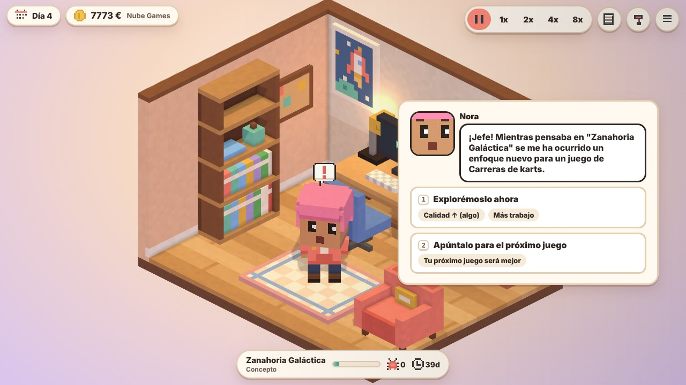

# EMPIRES — Little People. Big Ideas.

Videojuego premium de simulación y gestión en el que pequeños personajes voxel, los **Empirians**, construyen software en oficinas en miniatura y levantan un imperio tecnológico.

**Estado:** v0.5.0 — v0.1 jugable + "A Living Studio" (experiencia del fundador, oficina personalizable, Empires Daily, eventos, encargos) + primera contratación (Growing Together). Versión web para ordenador con soporte táctil. Pendiente: validación en móviles reales.

**Despliegue web:** rama `production-web`, instrucciones en [`docs/DEPLOY_WEB.md`](docs/DEPLOY_WEB.md), versiones en [`docs/WEB_RELEASES.md`](docs/WEB_RELEASES.md).



Galería de revisión visual: [`docs/screenshots/README.md`](docs/screenshots/README.md).

## Probarlo

Requiere Node ≥ 22.12 y npm ≥ 11 recomendado (`npm ci` funciona también con npm 10; ver D-028).

```bash
npm ci
```

```bash
npm run dev
```

Abre http://localhost:5173 (en horizontal si es un móvil en la misma red: `npm run dev -- --host`).

- Solo para desarrollo: `?debug` (diagnóstico y **partida de pruebas separada**, nunca toca la normal) · `?debug&fresh` partida de pruebas nueva · `?cam=iso` cámara isométrica.
- En ordenador: Espacio pausa, 1–4 velocidad, P proyecto, C encargos, N periódico, D decorar, T equipo, M menú (lista completa en el menú).

## Comprobaciones

```bash
npm test
```

```bash
npm run build
```

```bash
npm run sim
```

```bash
npm run e2e
```

(`npm run e2e` necesita `npm run dev` en marcha; `npm run gallery` regenera la galería y necesita `npm run build` + `npx vite preview --port 4173`.)

## Documentos

- [`CLAUDE.md`](CLAUDE.md) — instrucciones permanentes para Claude Code
- [`docs/DEVELOPMENT_LOG.md`](docs/DEVELOPMENT_LOG.md) — registro de desarrollo
- [`docs/GAME_DESIGN.md`](docs/GAME_DESIGN.md) — documento maestro de diseño
- [`docs/ROADMAP.md`](docs/ROADMAP.md) — fases, tareas y criterios de aceptación
- [`docs/DECISIONS.md`](docs/DECISIONS.md) — registro de decisiones
- [`docs/ART_DIRECTION.md`](docs/ART_DIRECTION.md) — identidad visual
- [`docs/ARCHITECTURE.md`](docs/ARCHITECTURE.md) — arquitectura técnica
- [`docs/ASSET_REGISTRY.md`](docs/ASSET_REGISTRY.md) — procedencia y licencias de recursos
- [`docs/DEPLOY_WEB.md`](docs/DEPLOY_WEB.md) — despliegue web (Hostinger) y partidas guardadas

© Todos los derechos reservados (D-016).
