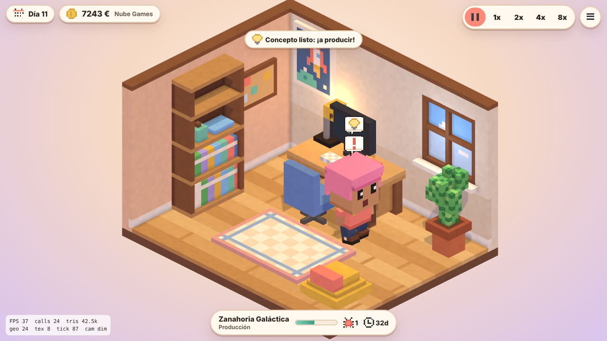

# EMPIRES — Little People. Big Ideas.

Videojuego premium de simulación y gestión en el que pequeños personajes voxel, los **Empirians**, construyen software en oficinas en miniatura y levantan un imperio tecnológico.

**Estado:** v0.1 "Primer Lanzamiento" jugable de principio a fin en navegador (F1–F2). Pendiente: prueba de juego del propietario y validación en móviles reales.



## Probarlo

```bash
npm install --legacy-peer-deps
```

```bash
npm run dev
```

Abre http://localhost:5173 (en horizontal si es un móvil en la misma red: `npm run dev -- --host`).

- `?debug` muestra diagnóstico de rendimiento · `?fresh` empieza partida nueva · `?cam=iso` cámara isométrica.

## Comprobaciones

```bash
npm test
```

```bash
npm run build
```

```bash
npm run sim
```

```bash
npm run e2e
```

(`npm run e2e` necesita `npm run dev` en marcha.)

## Documentos

- [`CLAUDE.md`](CLAUDE.md) — instrucciones permanentes para Claude Code
- [`docs/DEVELOPMENT_LOG.md`](docs/DEVELOPMENT_LOG.md) — registro de desarrollo
- [`docs/GAME_DESIGN.md`](docs/GAME_DESIGN.md) — documento maestro de diseño
- [`docs/ROADMAP.md`](docs/ROADMAP.md) — fases, tareas y criterios de aceptación
- [`docs/DECISIONS.md`](docs/DECISIONS.md) — registro de decisiones
- [`docs/ART_DIRECTION.md`](docs/ART_DIRECTION.md) — identidad visual
- [`docs/ARCHITECTURE.md`](docs/ARCHITECTURE.md) — arquitectura técnica
- [`docs/ASSET_REGISTRY.md`](docs/ASSET_REGISTRY.md) — procedencia y licencias de recursos

© Todos los derechos reservados (D-016).
